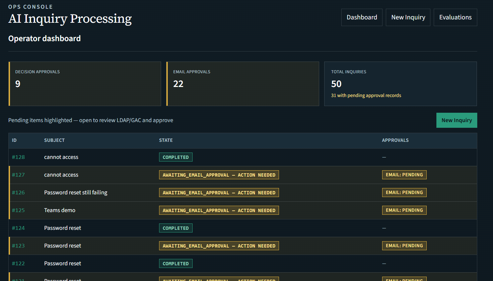
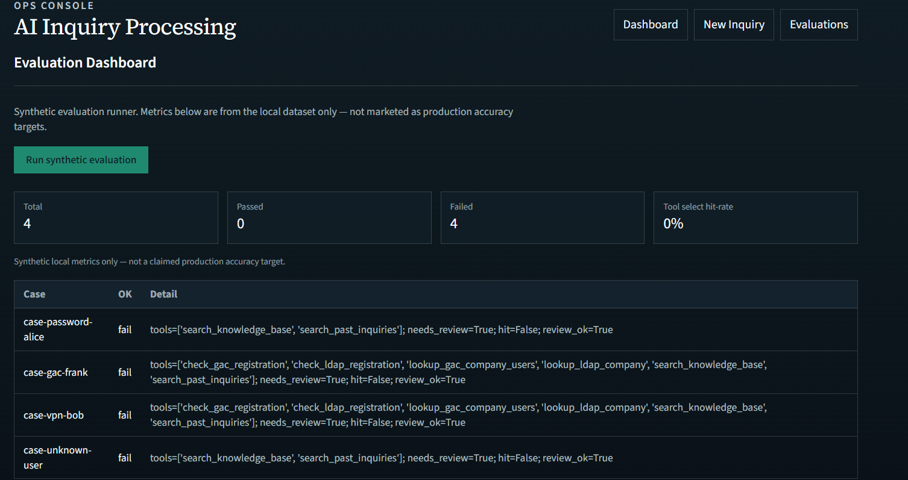

# AI Inquiry Processing Agent

A small local demo of an IT helpdesk assistant.

I built this to practice wiring a local LLM into a real workflow — not just chat, but lookup tools, validation rules, and **human approval before any email goes out**.

## What it does

1. Take in a helpdesk-style inquiry
2. Analyze it with a local model (Ollama) or a mock heuristic for offline/CI
3. Run allowlisted lookup tools (LDAP / GAC style checks against sample Excel data)
4. Ask an operator to approve the decision
5. Draft a reply from a template
6. Ask again before “send” (mock email provider in this demo)

## Stack

- **Backend:** Python, FastAPI, SQLAlchemy, Alembic, SQLite
- **Frontend:** Next.js (App Router)
- **AI:** Ollama (`qwen3:4b`, fallback `qwen3:1.7b`) or `AI_PROVIDER=mock`
- **Data:** sample Excel files under `data/sample/`

## Mock vs real

| Piece | In this repo |
|---|---|
| LLM | Real Ollama locally, or mock for CI / no GPU |
| LDAP / GAC lookups | Sample Excel (not a real directory) |
| Teams notifications | Mock |
| Email send | Mock after approval |
| Paid APIs (OpenAI / Graph) | Not required |

Tool results and RAG snippets come from real local runs/retrieval — they are not invented by the UI.

## Screenshots

| | |
|---|---|
|  | Dashboard — pending approvals and inquiry queue |
|  | New inquiry form |
|  | Decision approval (local LLM badge) |
|  | Email draft review before send |
|  | Completed flow after both approvals |
|  | Simple evaluation runner |

## Demo video

[Watch the walkthrough (MP4)](https://github.com/nori1021/ai-inquiry-processing-agent/releases/download/demo-video/demo-new-inquiry.mp4) · [Release page](https://github.com/nori1021/ai-inquiry-processing-agent/releases/tag/demo-video)

Covers: new inquiry → analysis → decision approval → email draft → completion. The file stays on the Release (not in git) because it is large (~82&nbsp;MB).

## Run locally (Windows)

### First-time setup

```powershell
cd C:\Project\ai-inquiry-processing-agent
py -3 -m venv .venv
.\.venv\Scripts\Activate.ps1
pip install -r backend\requirements.txt
python scripts\generate_sample_data.py
cd backend
alembic upgrade head
cd ..\frontend
npm install
```

Optional: install Ollama and pull a model (`ollama pull qwen3:4b`).

### One-command start

```bat
scripts\start-demo.bat
```

- UI: http://127.0.0.1:3000  
- API: http://127.0.0.1:8000  

```bat
REM Offline / CI style
set AI_PROVIDER=mock && scripts\start-demo.bat

REM Seed sample inquiries, then start
scripts\seed-and-start.bat

REM Stop ports 8000 / 3000
scripts\stop-demo.bat
```

PowerShell: `.\scripts\start-demo.ps1`, `.\scripts\stop-demo.ps1`.

### Manual start

Backend:

```powershell
.\.venv\Scripts\Activate.ps1
$env:AI_PROVIDER="ollama"
$env:OLLAMA_MODEL="qwen3:4b"
cd backend
uvicorn app.main:app --reload --host 127.0.0.1 --port 8000
```

Frontend:

```powershell
cd frontend
$env:NEXT_PUBLIC_API_BASE="http://127.0.0.1:8000"
npm run dev
```

### Tests

```powershell
cd backend
$env:AI_PROVIDER="mock"
..\.venv\Scripts\python.exe -m pytest -v

cd ..\frontend
npm test
```

## Docs

- [How I walk through the app](docs/demo.md)
- [Architecture](docs/architecture.md)
- [Workflow](docs/workflow.md)
- [Approval design](docs/approval_design.md)
- [API notes](docs/api_reference.md)
- [Ollama runtime](docs/ollama_runtime.md)
- [Tool registry](docs/tool_registry.md)

## Notes

- Copy `.env.example` if you want local overrides. Do not commit `.env`.
- Default email/Teams paths stay mocked on purpose so the demo is safe to show.
